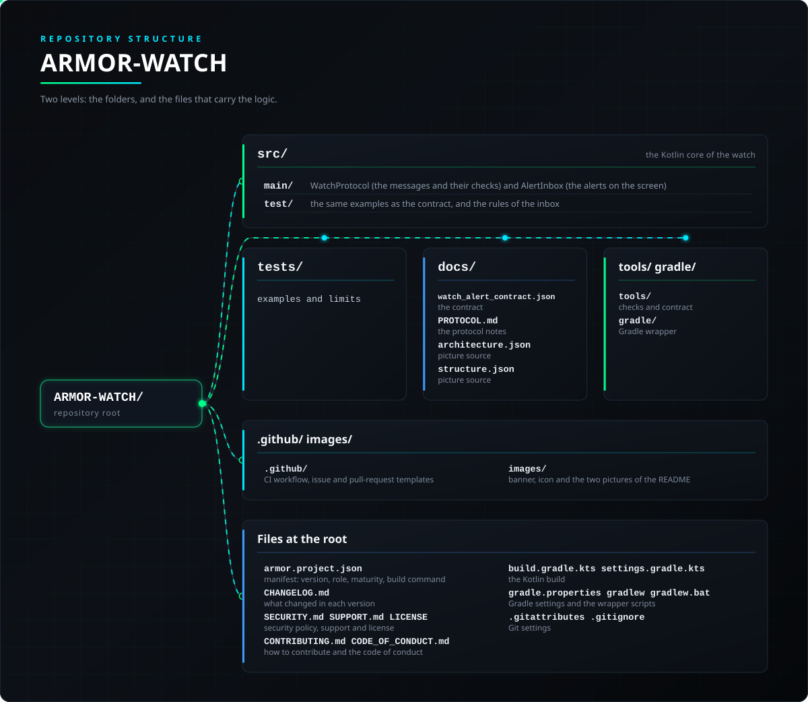

<p align="center">
  
</p>

# ⌚ ARMOR-WATCH

<p align="center">
  <a href="README.md">🇺🇸 English</a> |
  <a href="README_spa.md">🇪🇸 Español</a> |
  🇫🇷 <b>Français</b> |
  <a href="README_ita.md">🇮🇹 Italiano</a> |
  <a href="README_deu.md">🇩🇪 Deutsch</a> |
  <a href="README_zho.md">🇨🇳 简体中文</a> |
  <a href="README_jpn.md">🇯🇵 日本語</a> |
  <a href="README_por.md">🇵🇹 Português</a>
</p>

### La montre minimale d'A.R.M.O.R. : avis d'alarme et un toucher pour confirmer une alarme

<p align="center">
  
  
  
  
  
</p>

---

**Vérification d'honnêteté - ce qui fonctionne aujourd'hui :** Le contrat des messages, le noyau Kotlin et la session de la montre sont testés sur un ordinateur, et l'app Wear OS et le côté émetteur de l'app Android se compilent et passent leurs tests en CI ; **rien n'a tourné sur une vraie montre ni sur un émulateur, et l'iPhone n'a pas d'équivalent (il ne s'appaire pas avec une montre Wear OS).**

---

## 📋 En un coup d'œil

| | |
|---|---|
| Version | `0.0.1` |
| Maturité | Ébauche |
| Rôle | Le client montre minimal d'A.R.M.O.R. (famille : Clients, parent : ARMOR-ANDROID-CONTROL) |
| Stack | Kotlin (noyau JVM et l'app Wear OS avec Compose, Gradle) ; Python 3.11+ pour les vérifications |
| Tests | 10 en Python (`python -m unittest discover -s tests`) et les tests Kotlin (`./gradlew test`) |
| Messages | L'interrupteur du relais, une alerte, l'effacement d'une alerte et la confirmation en retour |
| Fonctionne sur | Tout ordinateur avec un JDK 21 (noyau) ; une montre Wear OS 3+ appairée au téléphone (app compilée en CI, jamais exécutée) |
| Sur matériel réel | Aucun pour l'instant : aucune montre ni émulateur ne l'a exécuté |
| Licence | GPL-3.0-or-later |

**Aller à :** [Présentation](#-présentation) · [Architecture](#-architecture) · [Sécurité](#-sécurité-et-protection) · [Configuration](#-configuration) · [Démarrage rapide](#-démarrage-rapide) · [Tests](#-tests) · [Dépannage](#-dépannage) · [Structure](#-structure-du-dépôt) · [Liés](#-projets-liés)

## 🚦 État du projet

Chaque ligne est une partie de ce dépôt et le feu dit où elle en est aujourd'hui. Elle est écrite d'après ce que le dépôt peut montrer (tests, compilations, exécutions), pas d'après ce qui est prévu.

🟢 Fait et vérifié · 🟡 Fonctionne, avec des limites connues · 🟠 À moitié fait ou pas encore vérifié · 🔴 Pas fait ou ne fonctionne pas

| Domaine | État | Ce que cela veut dire ici |
|---|---|---|
| Logiciel | 🟡 | Le noyau Kotlin lit et vérifie chaque message et garde les alertes en mémoire ; l'app Wear OS (écran et service Data Layer) et l'émetteur de l'app Android sont écrits. |
| Tests | 🟡 | 10 tests Python et les tests Kotlin exécutent les mêmes exemples acceptés et refusés du contrat ; les tests Kotlin tournent en CI. |
| Matériel | 🔴 | Aucune montre ni émulateur ne l'a exécutée ; l'app et le Data Layer sont seulement compilés et testés unitairement en CI. |
| Documentation | 🟡 | Huit langues, les notes du protocole et le contrat sont écrits et à jour. |

## 🎯 Présentation

* **Une montre minimale, pas une seconde app.** ARMOR-ANDROID-CONTROL et ARMOR-IOS-CONTROL restent le client complet ; la montre montre seulement les alarmes et avis que le téléphone choisit d'envoyer et laisse confirmer une alarme d'un toucher.
* **Seul le téléphone parle à ARMOR-SERVER.** La montre ne détient ni session, ni mot de passe, ni clé, et ne garde rien sur la montre : ce qu'elle montre est en mémoire et s'oublie à la fermeture de l'app.
* **Désactivé par défaut.** Rien n'arrive sur la montre tant que la personne n'active pas l'option des alertes de la montre dans l'app du téléphone ; tant que le téléphone ne le dit pas, la montre jette toute alerte reçue.
* **Quatre petits messages** (`relay`, `alert`, `alert_clear`, `alert_ack`) avec limites et exemples acceptés et refusés dans `docs/watch_alert_contract.json` ; le téléphone écrit les textes dans la langue de la personne, la montre n'a rien à traduire.
* **Aucun son ni vibration propres :** la montre n'en ajoute pas au-delà de la notification standard du système.

## 🧩 Rôle dans A.R.M.O.R.

ARMOR-WATCH est le bout du poignet des apps du téléphone. [ARMOR-ANDROID-CONTROL](https://github.com/JuanenRac/ARMOR-ANDROID-CONTROL) et [ARMOR-IOS-CONTROL](https://github.com/JuanenRac/ARMOR-IOS-CONTROL) gardent la session avec [ARMOR-SERVER](https://github.com/JuanenRac/ARMOR-SERVER) ; la montre reçoit une courte alerte du téléphone et renvoie l'identifiant d'une alarme confirmée par la personne, que le téléphone vérifie et exécute.

## 🏛️ Architecture

<p align="center">
  
</p>

## 🔒 Sécurité et protection

| Menace | Défense |
|---|---|
| Une montre qui montre encore des alertes après désactivation de l'option | Le téléphone envoie `relay` avec `enabled: false` et la montre oublie ce qu'elle montrait ; la boîte démarre désactivée |
| Un message falsifié ou mal formé | Chaque message est vérifié contre le contrat (type, version, limites, types exacts) et celui qui échoue est jeté sans erreur ; rien de plus de 4096 caractères n'est lu |
| Une montre volée avec une session dedans | Il n'y en a pas : la montre ne détient ni session, ni mot de passe, ni clé et n'écrit rien dans le stockage |
| Une confirmation envoyée deux fois ou pour une alarme absente | La confirmation part une fois par alerte, seulement pour une alerte qui la demande et n'a pas expiré ; le téléphone ignore un identifiant inconnu |
| L'alarme d'un PIN de contrainte affichée au poignet | Le téléphone ne l'envoie jamais (comme la bannière des apps du téléphone ne l'affiche jamais) |

## ⚙️ Configuration

| Réglage | Par défaut | Ce qu'il fait |
|---|---|---|
| `titleMax`, `textMax` | 60, 160 | Titre et texte les plus longs d'une alerte, en caractères |
| `ttlSeconds` | 5 - 600 | Combien de temps une alerte reste avant de disparaître d'elle-même |
| `pendingMax` | 8 | Alertes gardées à la fois ; une critique n'est jamais jetée pour une moindre |
| `rawMax` | 4096 | Un message plus long n'est pas lu |
| `relay.enabled` | false | Fixé par le téléphone ; la montre ne montre rien tant qu'il n'est pas vrai |

## 🚀 Démarrage rapide

**Prérequis :** Python 3.11+ pour les vérifications ; un JDK 21 pour le noyau Kotlin (le wrapper Gradle télécharge Gradle lui-même).

```powershell
python tools/watch_contract.py                  # the examples of the contract in Python
python -m unittest discover -s tests            # the contract, the Kotlin constants and the protocol notes
./gradlew test                                  # the Kotlin core (WatchProtocol and AlertInbox)
```

Voir les [notes du protocole](docs/PROTOCOL.md) pour les messages et ce que fait chaque côté.

## 🧪 Tests

```powershell
python -m unittest discover -s tests
./gradlew test
python -I tools/armor_ci_validate.py
```

| Fichier de tests | Tests | Ce qu'il couvre |
|---|---|---|
| `test_watch_contract.py` | 10 | Chaque exemple du contrat, les limites, les constantes Kotlin et les notes du protocole |
| `WatchProtocolTest.kt` | 6 | Les mêmes exemples contre le lecteur Kotlin, les limites et la confirmation |
| `AlertInboxTest.kt` | 10 | Désactivé par défaut, ordre, remplacement, expiration, effacement, une seule confirmation, la limite de huit |

Les tests Kotlin tournent en CI ; aucun test n'a tourné sur une montre ni sur un émulateur.

## 🩺 Dépannage

| Vous voyez | Parce que | Faites |
|---|---|---|
| Rien n'apparaît sur la montre | L'option des alertes de la montre est désactivée dans l'app du téléphone, ou le téléphone n'a pas envoyé `relay` avec `enabled: true` | Active l'option dans l'app du téléphone |
| Une alerte disparaît d'elle-même | Son `ttlSeconds` est écoulé ou le téléphone l'a effacée | Relance-la depuis le téléphone |
| La confirmation ne fait rien | L'alerte n'en demande pas, elle a expiré ou a déjà été confirmée une fois | Confirme l'alarme dans l'app du téléphone |

## 📂 Structure du dépôt

<p align="center">
  
</p>

<details>
<summary>Version texte de l'arborescence</summary>

```text
ARMOR-WATCH/
├── src/
│   ├── main/                               WatchProtocol (les messages et leurs contrôles) et AlertInbox (les alertes à l'écran)
│   └── test/                               les mêmes exemples que le contrat et les règles de la boîte
├── wear/
│   ├── src/                                l'écran, le service Data Layer et le runtime
│   └── build.gradle.kts                    la compilation de l'app (seulement avec -ParmorWear)
├── watchos/
│   ├── Sources/                            le noyau Swift : messages, boîte, session
│   └── App/                                l'écran et WatchConnectivity
├── tests/                                  le contrat vérifié en Python
├── docs/                                   le contrat et le protocole
├── tools/                                  contrôles et contrat
├── gradle/                                 wrapper Gradle
├── .github/                                workflow CI et modèles d'issues et de pull requests
├── images/                                 bannière, icône et les deux images du README
├── armor.project.json                      manifeste : version, rôle, maturité, commande de build
├── CHANGELOG.md                            ce qui a changé à chaque version
├── SECURITY.md SUPPORT.md LICENSE          politique de sécurité, support et licence
├── CONTRIBUTING.md CODE_OF_CONDUCT.md      comment contribuer et le code de conduite
├── build.gradle.kts settings.gradle.kts    le build Kotlin
├── gradle.properties gradlew gradlew.bat   réglages Gradle et scripts du wrapper
└── .gitattributes .gitignore               réglages de Git
```

</details>

## 🗺️ Feuille de route et limites connues

**Limites connues aujourd'hui**

* L'app Wear OS (`wear/`, compilée avec `-ParmorWear`) et l'émetteur d'ARMOR-ANDROID-CONTROL (désactivé par défaut) se compilent et passent leurs tests unitaires en CI, mais rien n'a tourné sur une vraie montre ni sur un émulateur.
* Un iPhone ne s'appaire pas avec une montre Wear OS, donc ARMOR-IOS-CONTROL n'a pas d'équivalent (une Apple Watch serait une autre app).
* Le contrat est conservé ici ; l'app Android garde les mêmes règles et exécute les mêmes exemples.

**Ensuite**

* Le prouver sur une vraie montre : l'appairer, activer l'option, lancer une alarme d'essai, la voir sur la montre, la confirmer d'un toucher et voir la confirmation dans ARMOR-SERVER ; puis désactiver l'option et voir l'alerte disparaître.

## 🌍 Langues

Le README et les textes existent en anglais, espagnol, français, italien, allemand, chinois, japonais et portugais européen.

## 🔗 Projets liés

**A.R.M.O.R.** (Autonomous Radar & Multimodal Observation Range) est un système de sécurité périmétrique composé de dépôts indépendants. Chacun a sa propre version, ses propres tests et son propre README ; voici la famille :

* **[ARMOR-COMMON](https://github.com/JuanenRac/ARMOR-COMMON)** - Contrats de messages, validateurs, vecteurs de conformité et types générés
* **[ARMOR-NODE-RADAR](https://github.com/JuanenRac/ARMOR-NODE-RADAR)** - Firmware du nœud de terrain pour ESP32-S3 avec trois radars et son propre panneau web
* **[ARMOR-NODE-SOLAR](https://github.com/JuanenRac/ARMOR-NODE-SOLAR)** - Protocoles des onduleurs et batteries solaires et messages d'un nœud passerelle
* **[ARMOR-NODE-ELECTRICAL](https://github.com/JuanenRac/ARMOR-NODE-ELECTRICAL)** - Nœud électrique : compteurs, le message des mesures du réseau et les règles de commutation
* **[ARMOR-NODE-ALARM](https://github.com/JuanenRac/ARMOR-NODE-ALARM)** - Nœud et centrale d'alarme : zones, armement, temporisations, sirène et PIN, avec ou sans le serveur
* **[ARMOR-NODE-HMI](https://github.com/JuanenRac/ARMOR-NODE-HMI)** - Panneau tactile : l'état du système sur un écran mural, armer et acquitter, et la maison de l'assistant vocal
* **[ARMOR-NETWORK](https://github.com/JuanenRac/ARMOR-NETWORK)** - Le réseau local : ses appareils, internet et ce qui change
* **[ARMOR-SERVER](https://github.com/JuanenRac/ARMOR-SERVER)** - Coordinateur central : télémétrie, alarmes, appareils, relevés solaires et caméras
* **[ARMOR-STUDIO](https://github.com/JuanenRac/ARMOR-STUDIO)** - Console web : caméras, radar, alarmes, énergie solaire et concepteur de site 2D/3D
* **[ARMOR-ANDROID-CONTROL](https://github.com/JuanenRac/ARMOR-ANDROID-CONTROL)** - Client Android de l'opérateur avec radar 2D/3D en direct
* **[ARMOR-IOS-CONTROL](https://github.com/JuanenRac/ARMOR-IOS-CONTROL)** - Client opérateur iPhone
* **ARMOR-WATCH** (ce dépôt) - Client montre minimal : avis d'alarme et confirmation d'alarme
* **[ARMOR-SERVER-AI](https://github.com/JuanenRac/ARMOR-SERVER-AI)** - Politique d'inférence visuelle qui explique ses décisions et n'agit jamais
* **[ARMOR-VISION](https://github.com/JuanenRac/ARMOR-VISION)** - Zones de caméra, masques et règles de détection pour la Jetson Orin NX
* **[ARMOR-VOICE-AI](https://github.com/JuanenRac/ARMOR-VOICE-AI)** - Intentions vocales hors ligne avec une confirmation impossible à falsifier
* **[ARMOR-HARDWARE](https://github.com/JuanenRac/ARMOR-HARDWARE)** - Boîtiers, électronique et matrice d'acceptation sur banc
* **[ARMOR-DEVOPS](https://github.com/JuanenRac/ARMOR-DEVOPS)** - Déploiement, banc d'essai CM5, sauvegarde et TLS
* **[ARMOR-SIMULATOR](https://github.com/JuanenRac/ARMOR-SIMULATOR)** - Simulateur de télémétrie hors ligne avec des pannes reproductibles
* **[ARMOR-UPDATER](https://github.com/JuanenRac/ARMOR-UPDATER)** - Détecte, installe et met à jour les propres dépôts de l'écosystème
* **[ARMOR-DOCS](https://github.com/JuanenRac/ARMOR-DOCS)** - Architecture, base de sécurité et matrice des capacités

## 📚 Documentation

* [Notes du protocole](docs/PROTOCOL.md) : comment le téléphone et la montre se parlent
* [Contrat des messages](docs/watch_alert_contract.json) : les messages, les limites et les exemples acceptés et refusés
* [Matrice des capacités : ce qui est prouvé et ce qui ne l'est pas](https://github.com/JuanenRac/ARMOR-DOCS/blob/main/docs/CAPABILITY_MATRIX.md)
* [Catalogue des projets : versions et dépendances entre les dépôts](https://github.com/JuanenRac/ARMOR-DOCS/blob/main/docs/PROJECT_CATALOG.md)
* [Historique des modifications de ce dépôt](CHANGELOG.md)

## 🤝 Contribuer et communauté

* Avant une pull request, lance `python -m unittest discover -s tests` et `python -I tools/armor_ci_validate.py` : cela doit passer. Voir [CONTRIBUTING.md](CONTRIBUTING.md) et le [code de conduite](CODE_OF_CONDUCT.md).
* Le README existe en huit langues et est généré à partir des sources d'ARMOR-DOCS : une modification du texte se fait là-bas.
* Une modification d'un message entre composants commence dans ARMOR-COMMON.
* Ne décrivez pas comme fonctionnant sur une carte ce qui a seulement été compilé.
* Signalez une vulnérabilité en privé : [SECURITY.md](SECURITY.md). Questions, idées et rapports : electrohobby3d@gmail.com ([SUPPORT.md](SUPPORT.md)).

## 👤 AUTEUR

**JuanenRac (Electro Hobby 3D)** · electrohobby3d@gmail.com

## 📜 LICENCE

GPL-3.0-or-later - voir [LICENSE](LICENSE).
