<p align="center">
  
</p>

# ⌚ ARMOR-WATCH

<p align="center">
  <a href="README.md">🇺🇸 English</a> |
  <a href="README_spa.md">🇪🇸 Español</a> |
  <a href="README_fra.md">🇫🇷 Français</a> |
  🇮🇹 <b>Italiano</b> |
  <a href="README_deu.md">🇩🇪 Deutsch</a> |
  <a href="README_zho.md">🇨🇳 简体中文</a> |
  <a href="README_jpn.md">🇯🇵 日本語</a> |
  <a href="README_por.md">🇵🇹 Português</a>
</p>

### L'orologio minimale di A.R.M.O.R.: avvisi di allarme e un tocco per confermare un allarme

<p align="center">
  
  
  
  
  
</p>

---

**Controllo di onestà - cosa funziona oggi:** Il contratto dei messaggi, i nuclei Kotlin e Swift e la sessione dell'orologio sono testati su un computer, e l'app Wear OS, l'app Apple Watch e il lato che invia delle app Android e iPhone si compilano e superano i test in CI; **nulla è stato eseguito su un orologio reale né su un emulatore (solo un gemello simulato di telefono, collegamento e orologio), e l'app Apple Watch, compilata nel progetto dell'iPhone, non è mai stata associata a un iPhone reale.**

---

## 📋 In breve

| | |
|---|---|
| Versione | `0.0.3` |
| Maturità | Impalcatura |
| Ruolo | Il client orologio minimale di A.R.M.O.R. (famiglia: Clients, genitore: ARMOR-ANDROID-CONTROL) |
| Stack | Kotlin (nucleo JVM e app Wear OS con Compose, Gradle), Swift (nucleo e app Apple Watch con SwiftUI); Python 3.11+ per i controlli |
| Test | 124 (72 in Python (`python -m unittest discover -s tests`) e 52 in Kotlin (`./gradlew test`)) |
| Messaggi | L'interruttore del relay, un avviso, la cancellazione di un avviso e la conferma di ritorno |
| Funziona su | Qualsiasi computer con JDK 21 (nucleo Kotlin) o un Mac (nucleo Swift); un orologio Wear OS 3+ o un Apple Watch associato al telefono (app compilate in CI, mai eseguite) |
| Su hardware reale | Ancora nessuno: l'ha eseguito solo un gemello simulato; la prova su un orologio reale è da fare |
| Simulazione e APK | Il gemello simulato (`tools/watch_simulation.py`) collega in memoria il telefono, il collegamento con guasti e l'orologio; l'app Wear OS (`wear/`) e l'app Apple Watch (`watchos/`) stanno in questo stesso repository, e l'APK di rilascio di Wear OS è firmato fuori da GitHub come `ARMOR-WATCH-release.apk` |
| Licenza | GPL-3.0-or-later |

**Vai a:** [Panoramica](#-panoramica) · [Architettura](#-architettura) · [Sicurezza](#-sicurezza-e-protezione) · [Configurazione](#-configurazione) · [Avvio rapido](#-avvio-rapido) · [Test](#-test) · [Problemi](#-risoluzione-dei-problemi) · [Struttura](#-struttura-del-repository) · [Correlati](#-progetti-correlati)

## 🚦 Stato del progetto

Ogni riga è una parte di questo repository e il semaforo dice a che punto è oggi. È scritta in base a ciò che il repository può mostrare (test, compilazioni, esecuzioni), non a ciò che è previsto.

🟢 Fatto e verificato · 🟡 Funziona, con limiti noti · 🟠 Fatto a metà o non ancora verificato · 🔴 Non fatto o non funzionante

| Area | Stato | Cosa significa qui |
|---|---|---|
| Software | 🟡 | I nuclei Kotlin e Swift leggono e controllano ogni messaggio e tengono gli avvisi in memoria; l'app Wear OS, l'app Apple Watch e i mittenti delle app Android e iPhone sono scritti. |
| Test | 🟡 | 72 test Python e i test Kotlin eseguono gli stessi esempi accettati e rifiutati del contratto; i test Kotlin girano in CI. |
| Hardware | 🟠 | Nessun orologio reale né emulatore le ha eseguite; un gemello simulato (`tools/watch_simulation.py`) esegue tutta la conversazione in memoria (prova: simulatore), e la prova su un orologio reale resta da fare. |
| Documentazione | 🟡 | Otto lingue, le note del protocollo e il contratto sono scritti e aggiornati. |

## 🎯 Panoramica

* **Un orologio minimale, non una seconda app.** ARMOR-ANDROID-CONTROL e ARMOR-IOS-CONTROL restano il client completo; l'orologio mostra solo gli allarmi e gli avvisi che il telefono sceglie di inviare e permette di confermare un allarme con un tocco.
* **Solo il telefono parla con ARMOR-SERVER.** L'orologio non ha sessione, password né chiave e non conserva nulla sull'orologio: ciò che mostra è in memoria e si dimentica alla chiusura dell'app.
* **Spento per impostazione predefinita.** Nulla arriva all'orologio finché la persona non attiva l'opzione degli avvisi dell'orologio nell'app del telefono; finché il telefono non lo dice, l'orologio scarta ogni avviso ricevuto.
* **Quattro piccoli messaggi** (`relay`, `alert`, `alert_clear`, `alert_ack`) con limiti ed esempi accettati e rifiutati in `docs/watch_alert_contract.json`; il telefono scrive i testi nella lingua della persona, l'orologio non ha nulla da tradurre.
* **Nessun suono o vibrazione propri:** l'orologio non ne aggiunge oltre alla notifica standard del sistema.

## 🧩 Ruolo in A.R.M.O.R.

ARMOR-WATCH è l'estremità al polso delle app del telefono. [ARMOR-ANDROID-CONTROL](https://github.com/JuanenRac/ARMOR-ANDROID-CONTROL) e [ARMOR-IOS-CONTROL](https://github.com/JuanenRac/ARMOR-IOS-CONTROL) mantengono la sessione con [ARMOR-SERVER](https://github.com/JuanenRac/ARMOR-SERVER); l'orologio riceve un breve avviso dal telefono e restituisce l'identificatore di un allarme confermato dalla persona, che il telefono controlla ed esegue.

## 🏛️ Architettura

<p align="center">
  
</p>

## 🔒 Sicurezza e protezione

| Minaccia | Difesa |
|---|---|
| Un orologio che mostra ancora avvisi dopo aver spento l'opzione | Il telefono invia `relay` con `enabled: false` e l'orologio dimentica ciò che mostrava; la casella parte spenta |
| Un messaggio falsificato o malformato | Ogni messaggio è controllato contro il contratto (tipo, versione, limiti, tipi esatti) e quello che fallisce viene scartato senza errore; non si legge nulla oltre 4096 caratteri |
| Un orologio rubato con una sessione dentro | Non c'è: l'orologio non ha sessione, password né chiave e non scrive nulla nella memoria |
| Una conferma inviata due volte o per un allarme inesistente | La conferma parte una volta per avviso, solo per un avviso che la chiede e non è scaduto; il telefono ignora un identificatore sconosciuto |
| L'allarme di un PIN di coercizione mostrato al polso | Il telefono non lo invia mai (come il banner delle app del telefono non lo mostra mai) |

## ⚙️ Configurazione

| Impostazione | Predefinito | Cosa fa |
|---|---|---|
| `titleMax`, `textMax` | 60, 160 | Titolo e testo più lunghi di un avviso, in caratteri |
| `ttlSeconds` | 5 - 600 | Quanto resta un avviso prima di sparire da solo |
| `pendingMax` | 8 | Avvisi tenuti insieme; uno critico non viene mai scartato per uno minore |
| `rawMax` | 4096 | Un messaggio più lungo non viene letto |
| `relay.enabled` | false | Impostato dal telefono; l'orologio non mostra nulla finché non è vero |
| `bindSender` | false | Solo Wear OS; si imposta dall'app. Acceso, l'orologio ascolta solo il telefono che ha attivato gli avvisi, finché non vengono spenti; spento, qualsiasi telefono a portata può inviare |

## 🚀 Avvio rapido

**Requisiti:** Python 3.11+ per i controlli; un JDK 21 per il nucleo Kotlin (il wrapper di Gradle scarica Gradle stesso).

```powershell
python tools/watch_contract.py                  # the examples of the contract in Python
python -m unittest discover -s tests            # the contract, the Kotlin constants and the protocol notes
./gradlew test                                  # the Kotlin core (WatchProtocol and AlertInbox)
```

Vedi le [note del protocollo](docs/PROTOCOL.md) per i messaggi e cosa fa ogni lato.

## 🧪 Test

```powershell
python -m unittest discover -s tests
./gradlew test
python -I tools/armor_ci_validate.py
```

| File di test | Test | Cosa copre |
|---|---|---|
| `test_watch_contract.py` | 13 | Ogni esempio del contratto, i limiti, le costanti Kotlin e le note del protocollo |
| `test_watch_simulation.py` | 16 | La conversazione simulata tra telefono e orologio con guasti sul collegamento, con gli stessi scenari di Kotlin |
| `WatchProtocolTest.kt` | 6 | Gli stessi esempi contro il parser Kotlin, i limiti e la conferma |
| `AlertInboxTest.kt` | 10 | Spento di default, ordine, sostituzione, scadenza, cancellazione, una sola conferma, il limite di otto |
| `WatchSessionTest.kt` | 11 | La conversazione dell'orologio con un telefono che esiste solo in memoria |
| `SimulatedPairTest.kt` | 14 | Telefono, collegamento e orologio simulati con guasti voluti, su un orologio che il test fa avanzare |
| `WatchRuntimeTest.kt` | 5 | La sessione condivisa dell'app Wear OS, il percorso degli avvisi e il pulsante |
| `ArmorWatchCoreTests.swift` | 18 | Il nucleo Swift dell'app Apple Watch contro gli stessi esempi del contratto |

I test Kotlin girano in CI; nessun test è stato eseguito su un orologio o su un emulatore. Il gemello simulato (`tools/watch_simulation.py`) esegue tutta la conversazione in memoria, con guasti sul collegamento.

## 🩺 Risoluzione dei problemi

| Vedi | Perché | Fai |
|---|---|---|
| Sull'orologio non appare nulla | L'opzione degli avvisi dell'orologio è spenta nell'app del telefono, o il telefono non ha inviato `relay` con `enabled: true` | Attiva l'opzione nell'app del telefono |
| Un avviso sparisce da solo | Il suo `ttlSeconds` è scaduto o il telefono l'ha cancellato | Rilancialo dal telefono |
| La conferma non fa nulla | L'avviso non la richiede, è scaduto o è già stato confermato una volta | Conferma l'allarme nell'app del telefono |

## 📂 Struttura del repository

<p align="center">
  
</p>

<details>
<summary>Versione testuale dell'albero</summary>

```text
ARMOR-WATCH/
├── src/
│   ├── main/                               WatchProtocol (i messaggi e i loro controlli) e AlertInbox (gli avvisi sullo schermo)
│   └── test/                               gli stessi esempi del contratto e le regole della casella
├── wear/
│   ├── src/                                lo schermo, il servizio Data Layer e il runtime
│   └── build.gradle.kts                    la compilazione dell'app (solo con -ParmorWear)
├── watchos/
│   ├── Sources/                            il nucleo Swift: messaggi, casella, sessione
│   └── App/                                lo schermo e WatchConnectivity
├── tests/                                  il contratto verificato in Python
├── docs/                                   il contratto e il protocollo
├── tools/                                  controlli e contratto
├── gradle/                                 wrapper Gradle
├── .github/                                workflow CI e modelli per issue e pull request
├── images/                                 banner, icona e le due immagini del README
├── armor.project.json                      manifesto: versione, ruolo, maturità, comando di build
├── CHANGELOG.md                            cosa è cambiato in ogni versione
├── SECURITY.md SUPPORT.md LICENSE          politica di sicurezza, supporto e licenza
├── CONTRIBUTING.md CODE_OF_CONDUCT.md      come contribuire e il codice di condotta
├── build.gradle.kts settings.gradle.kts    il build Kotlin
├── gradle.properties gradlew gradlew.bat   impostazioni Gradle e script del wrapper
└── .gitattributes .gitignore               impostazioni di Git
```

</details>

## 🗺️ Roadmap e limiti noti

**Limiti noti oggi**

* L'app Wear OS (`wear/`, compilata con `-ParmorWear`), l'app Apple Watch (`watchos/`, compilata solo su un Mac) e i mittenti di ARMOR-ANDROID-CONTROL e ARMOR-IOS-CONTROL (spenti per impostazione predefinita) si compilano e superano i test in CI, ma nulla è stato eseguito su un orologio reale, un emulatore o un simulatore.
* L'app Apple Watch è compilata nel progetto dell'iPhone (incorporata in ARMOR-IOS-CONTROL e compilata per il simulatore in CI), ma l'associazione dei due è ancora da provare su dispositivi reali; un iPhone non si associa a un orologio Wear OS né un telefono Android a un Apple Watch.
* Il contratto è custodito qui; il nucleo Kotlin, il nucleo Swift e le app del telefono eseguono gli stessi esempi.

**Prossimi passi**

* Provarlo su un orologio reale di ciascun tipo: associarlo, attivare l'opzione, lanciare un allarme di prova, vederlo sull'orologio, confermarlo con un tocco e vedere la conferma in ARMOR-SERVER; poi spegnere l'opzione e vedere sparire l'avviso.

## 🌍 Lingue

Il README e i testi esistono in inglese, spagnolo, francese, italiano, tedesco, cinese, giapponese e portoghese europeo.

## 🔗 Progetti correlati

**A.R.M.O.R.** (Autonomous Radar & Multimodal Observation Range) è un sistema di sicurezza perimetrale fatto di repository indipendenti. Ognuno ha la propria versione, i propri test e il proprio README; ecco la famiglia:

* **[ARMOR-COMMON](https://github.com/JuanenRac/ARMOR-COMMON)** - Contratti dei messaggi, validatori, vettori di conformità e tipi generati
* **[ARMOR-NODE-RADAR](https://github.com/JuanenRac/ARMOR-NODE-RADAR)** - Firmware del nodo di campo per ESP32-S3 con tre radar e un proprio pannello web
* **[ARMOR-NODE-SOLAR](https://github.com/JuanenRac/ARMOR-NODE-SOLAR)** - Protocolli di inverter e batterie solari e messaggi di un nodo gateway
* **[ARMOR-NODE-ELECTRICAL](https://github.com/JuanenRac/ARMOR-NODE-ELECTRICAL)** - Nodo elettrico: contatori, il messaggio delle letture della rete e le regole di manovra
* **[ARMOR-NODE-ALARM](https://github.com/JuanenRac/ARMOR-NODE-ALARM)** - Nodo e centrale d'allarme: zone, inserimento, ritardi, sirena e PIN, con il server o senza
* **[ARMOR-NODE-HMI](https://github.com/JuanenRac/ARMOR-NODE-HMI)** - Pannello touch: lo stato del sistema su uno schermo a parete, attivare e riconoscere gli allarmi, e la casa dell'assistente vocale
* **[ARMOR-NODE-SOLAR-HMI](https://github.com/JuanenRac/ARMOR-NODE-SOLAR-HMI)** - Schermo touch solare: batterie e inverter come li conosce ARMOR-SERVER (fase iniziale: ancora senza firmware)
* **[ARMOR-NETWORK](https://github.com/JuanenRac/ARMOR-NETWORK)** - La rete locale: i suoi dispositivi, internet e ciò che cambia
* **[ARMOR-SERVER](https://github.com/JuanenRac/ARMOR-SERVER)** - Coordinatore centrale: telemetria, allarmi, dispositivi, letture solari e telecamere
* **[ARMOR-STUDIO](https://github.com/JuanenRac/ARMOR-STUDIO)** - Console web: telecamere, radar, allarmi, energia solare e progettista del sito 2D/3D
* **[ARMOR-ANDROID-CONTROL](https://github.com/JuanenRac/ARMOR-ANDROID-CONTROL)** - Client Android dell'operatore con radar 2D/3D in tempo reale
* **[ARMOR-IOS-CONTROL](https://github.com/JuanenRac/ARMOR-IOS-CONTROL)** - Client operatore per iPhone
* **ARMOR-WATCH** (questo repository) - Client orologio minimale: avvisi di allarme e conferma dell'allarme
* **[ARMOR-SERVER-AI](https://github.com/JuanenRac/ARMOR-SERVER-AI)** - Politica di inferenza visiva che spiega le sue decisioni e non agisce mai
* **[ARMOR-VISION](https://github.com/JuanenRac/ARMOR-VISION)** - Zone delle telecamere, maschere e regole di rilevamento per la Jetson Orin NX
* **[ARMOR-VOICE-AI](https://github.com/JuanenRac/ARMOR-VOICE-AI)** - Intenti vocali offline con una conferma impossibile da falsificare
* **[ARMOR-HARDWARE](https://github.com/JuanenRac/ARMOR-HARDWARE)** - Contenitori, elettronica e matrice di accettazione da banco
* **[ARMOR-DEVOPS](https://github.com/JuanenRac/ARMOR-DEVOPS)** - Distribuzione, banco di prova CM5, backup e TLS
* **[ARMOR-SIMULATOR](https://github.com/JuanenRac/ARMOR-SIMULATOR)** - Simulatore di telemetria offline con guasti ripetibili
* **[ARMOR-UPDATER](https://github.com/JuanenRac/ARMOR-UPDATER)** - Rileva, installa e aggiorna i repository stessi dell'ecosistema
* **[ARMOR-DOCS](https://github.com/JuanenRac/ARMOR-DOCS)** - Architettura, base di sicurezza e matrice delle capacità

## 📚 Documentazione

* [Note del protocollo](docs/PROTOCOL.md): come parlano telefono e orologio
* [Contratto dei messaggi](docs/watch_alert_contract.json): i messaggi, i limiti e gli esempi accettati e rifiutati
* [Matrice delle capacità: cosa è provato e cosa no](https://github.com/JuanenRac/ARMOR-DOCS/blob/main/docs/CAPABILITY_MATRIX.md)
* [Catalogo dei progetti: versioni e dipendenze tra i repository](https://github.com/JuanenRac/ARMOR-DOCS/blob/main/docs/PROJECT_CATALOG.md)
* [Cronologia delle modifiche di questo repository](CHANGELOG.md)

## 🤝 Contribuire e comunità

* Prima di una pull request esegui `python -m unittest discover -s tests` e `python -I tools/armor_ci_validate.py`: deve passare. Vedi [CONTRIBUTING.md](CONTRIBUTING.md) e il [codice di condotta](CODE_OF_CONDUCT.md).
* Il README esiste in otto lingue ed è generato dalle sorgenti in ARMOR-DOCS: una modifica al testo si fa lì.
* Una modifica a un messaggio tra componenti parte da ARMOR-COMMON.
* Non descrivere come funzionante su una scheda ciò che è stato solo compilato.
* Segnala una vulnerabilità in privato: [SECURITY.md](SECURITY.md). Domande, idee e segnalazioni: electrohobby3d@gmail.com ([SUPPORT.md](SUPPORT.md)).

## 👤 AUTORE

**JuanenRac (Electro Hobby 3D)** · electrohobby3d@gmail.com

## 📜 LICENZA

GPL-3.0-or-later - vedi [LICENSE](LICENSE).
