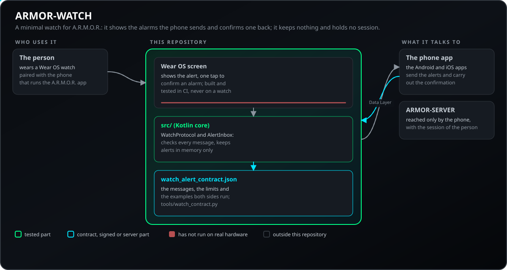

<p align="center">
  
</p>

# ⌚ ARMOR-WATCH

<p align="center">
  <a href="README.md">🇺🇸 English</a> |
  <a href="README_spa.md">🇪🇸 Español</a> |
  <a href="README_fra.md">🇫🇷 Français</a> |
  <a href="README_ita.md">🇮🇹 Italiano</a> |
  <a href="README_deu.md">🇩🇪 Deutsch</a> |
  <a href="README_zho.md">🇨🇳 简体中文</a> |
  <a href="README_jpn.md">🇯🇵 日本語</a> |
  🇵🇹 <b>Português</b>
</p>

### O relógio mínimo do A.R.M.O.R.: avisos de alarme e um toque para confirmar um alarme

<p align="center">
  
  
  
  
  
</p>

---

**Verificação de honestidade - o que funciona hoje:** O contrato das mensagens, os núcleos Kotlin e Swift e a sessão do relógio são testados num computador, e a app Wear OS, a app do Apple Watch e o lado que envia das apps Android e iPhone compilam e passam os seus testes na CI; **nada correu num relógio real, num emulador nem num simulador, e a app do Apple Watch, compilada dentro do projeto do iPhone, nunca foi emparelhada com um iPhone real.**

---

## 📋 Num relance

| | |
|---|---|
| Versão | `0.0.2` |
| Maturidade | Estrutura inicial |
| Função | O cliente de relógio mínimo do A.R.M.O.R. (família: Clients, pai: ARMOR-ANDROID-CONTROL) |
| Stack | Kotlin (núcleo JVM e a app Wear OS com Compose, Gradle), Swift (núcleo e a app do Apple Watch com SwiftUI); Python 3.11+ para as verificações |
| Testes | 29 em Python (`python -m unittest discover -s tests`) e os testes Kotlin (`./gradlew test`) |
| Mensagens | O interruptor do relé, um alerta, a limpeza de um alerta e a confirmação de volta |
| Corre em | Qualquer computador com JDK 21 (núcleo Kotlin) ou um Mac (núcleo Swift); um relógio Wear OS 3+ ou um Apple Watch emparelhado com o telemóvel (apps compiladas na CI, nunca executadas) |
| Em hardware real | Nenhum ainda: nenhum relógio ou emulador o executou |
| Licença | GPL-3.0-or-later |

**Ir para:** [Visão geral](#-visão-geral) · [Arquitetura](#-arquitetura) · [Segurança](#-segurança-e-proteção) · [Configuração](#-configuração) · [Início rápido](#-início-rápido) · [Testes](#-testes) · [Problemas](#-resolução-de-problemas) · [Estrutura](#-estrutura-do-repositório) · [Relacionados](#-projetos-relacionados)

## 🚦 Estado do projeto

Cada linha é uma parte deste repositório e a luz diz até onde chega hoje. É escrita com o que o repositório consegue demonstrar (testes, compilações, execuções), não com o que está previsto.

🟢 Feito e verificado · 🟡 Funciona, com limites conhecidos · 🟠 Feito a meio ou ainda por verificar · 🔴 Por fazer ou a não funcionar

| Área | Estado | O que significa aqui |
|---|---|---|
| Software | 🟡 | Os núcleos Kotlin e Swift lêem e verificam cada mensagem e guardam os alertas em memória; a app Wear OS, a app do Apple Watch e os emissores das apps Android e iPhone estão escritos. |
| Testes | 🟡 | 29 testes Python e os testes Kotlin executam os mesmos exemplos aceites e recusados do contrato; os testes Kotlin correm na CI. |
| Hardware | 🔴 | Nenhum relógio, emulador nem simulador as executou; as apps só são compiladas e testadas com testes unitários na CI. |
| Documentação | 🟡 | Oito idiomas, as notas do protocolo e o contrato estão escritos e atualizados. |

## 🎯 Visão geral

* **Um relógio mínimo, não uma segunda app.** O ARMOR-ANDROID-CONTROL e o ARMOR-IOS-CONTROL continuam a ser o cliente completo; o relógio só mostra os alarmes e avisos que o telemóvel escolhe enviar e deixa confirmar um alarme com um toque.
* **Só o telemóvel fala com o ARMOR-SERVER.** O relógio não guarda sessão, palavra-passe nem chave, e não guarda nada no relógio: o que mostra está em memória e esquece-se ao fechar a app.
* **Desligado por predefinição.** Nada chega ao relógio até a pessoa ativar a opção dos alertas do relógio na app do telemóvel; enquanto o telemóvel não o disser, o relógio descarta todo o alerta que receba.
* **Quatro mensagens pequenas** (`relay`, `alert`, `alert_clear`, `alert_ack`) com limites e exemplos aceites e recusados em `docs/watch_alert_contract.json`; o telemóvel escreve os textos na língua da pessoa, por isso o relógio não tem nada para traduzir.
* **Sem som nem vibração próprios:** o relógio não acrescenta nenhum além da notificação normal do sistema.

## 🧩 Papel no A.R.M.O.R.

O ARMOR-WATCH é o lado do pulso das apps do telemóvel. O [ARMOR-ANDROID-CONTROL](https://github.com/JuanenRac/ARMOR-ANDROID-CONTROL) e o [ARMOR-IOS-CONTROL](https://github.com/JuanenRac/ARMOR-IOS-CONTROL) mantêm a sessão com o [ARMOR-SERVER](https://github.com/JuanenRac/ARMOR-SERVER); o relógio recebe um alerta curto do telemóvel e devolve o identificador de um alarme que a pessoa confirmou, que o telemóvel verifica e executa.

## 🏛️ Arquitetura

<p align="center">
  
</p>

## 🔒 Segurança e proteção

| Ameaça | Defesa |
|---|---|
| Um relógio que ainda mostra alertas com a opção desligada | O telemóvel envia `relay` com `enabled: false` e o relógio esquece o que mostrava; a caixa arranca desligada |
| Uma mensagem falsificada ou mal formada | Cada mensagem é verificada contra o contrato (tipo, versão, limites, tipos exatos) e a que falha é descartada sem erro; nada com mais de 4096 carateres é lido |
| Um relógio roubado com uma sessão lá dentro | Não há: o relógio não guarda sessão, palavra-passe nem chave e não escreve nada no armazenamento |
| Uma confirmação enviada duas vezes ou para um alarme que não existe | A confirmação sai uma vez por alerta, só para um alerta que a peça e não tenha caducado; o telemóvel ignora um identificador que não conhece |
| O alarme de um PIN de coação mostrado no pulso | O telemóvel nunca o envia (tal como o aviso das apps do telemóvel nunca o mostra) |

## ⚙️ Configuração

| Definição | Predefinição | O que faz |
|---|---|---|
| `titleMax`, `textMax` | 60, 160 | Título e texto mais longos de um alerta, em carateres |
| `ttlSeconds` | 5 - 600 | Quanto tempo um alerta fica antes de desaparecer sozinho |
| `pendingMax` | 8 | Alertas guardados ao mesmo tempo; um crítico nunca é descartado por um menor |
| `rawMax` | 4096 | Uma mensagem mais longa não é lida |
| `relay.enabled` | false | Definido pelo telemóvel; o relógio não mostra nada até ser verdadeiro |

## 🚀 Início rápido

**Requisitos:** Python 3.11+ para as verificações; um JDK 21 para o núcleo Kotlin (o wrapper do Gradle descarrega o próprio Gradle).

```powershell
python tools/watch_contract.py                  # the examples of the contract in Python
python -m unittest discover -s tests            # the contract, the Kotlin constants and the protocol notes
./gradlew test                                  # the Kotlin core (WatchProtocol and AlertInbox)
```

Vê as [notas do protocolo](docs/PROTOCOL.md) para as mensagens e o que faz cada lado.

## 🧪 Testes

```powershell
python -m unittest discover -s tests
./gradlew test
python -I tools/armor_ci_validate.py
```

| Ficheiro de testes | Testes | O que cobre |
|---|---|---|
| `test_watch_contract.py` | 10 | Cada exemplo do contrato, os limites, as constantes Kotlin e as notas do protocolo |
| `WatchProtocolTest.kt` | 6 | Os mesmos exemplos contra o leitor Kotlin, os limites e a confirmação |
| `AlertInboxTest.kt` | 10 | Desligado por predefinição, ordem, substituição, caducidade, limpeza, uma só confirmação, o limite de oito |
| `WatchSessionTest.kt` | 11 | A conversa do relógio com um telemóvel que só existe em memória |
| `WatchRuntimeTest.kt` | 5 | A sessão partilhada da app Wear OS, o caminho dos alertas e o botão |
| `ArmorWatchCoreTests.swift` | 18 | O núcleo Swift da app Apple Watch contra os mesmos exemplos do contrato |

Os testes Kotlin correm na CI; nenhum teste correu num relógio ou num emulador.

## 🩺 Resolução de problemas

| Vê | Porque | Faça |
|---|---|---|
| Nada aparece no relógio | A opção dos alertas do relógio está desligada na app do telemóvel, ou o telemóvel não enviou `relay` com `enabled: true` | Ativa a opção na app do telemóvel |
| Um alerta desaparece sozinho | O seu `ttlSeconds` acabou ou o telemóvel limpou-o | Volta a lançá-lo a partir do telemóvel |
| A confirmação não faz nada | O alerta não a pede, caducou ou já foi confirmado uma vez | Confirma o alarme na app do telemóvel |

## 📂 Estrutura do repositório

<p align="center">
  
</p>

<details>
<summary>Versão em texto da árvore</summary>

```text
ARMOR-WATCH/
├── src/
│   ├── main/                               WatchProtocol (as mensagens e as suas verificações) e AlertInbox (os alertas no ecrã)
│   └── test/                               os mesmos exemplos do contrato e as regras da caixa
├── wear/                               a app Wear OS: ecrã, serviço Data Layer e runtime
├── watchos/                            a app do Apple Watch: núcleo Swift, ecrã e WatchConnectivity
├── tests/                                  o contrato verificado em Python
├── docs/                                   o contrato e o protocolo
├── tools/                                  verificações e contrato
├── gradle/                                 wrapper do Gradle
├── .github/                                fluxo de CI e modelos de issues e pull requests
├── images/                                 banner, ícone e os dois desenhos do README
├── armor.project.json                      manifesto: versão, função, maturidade, comando de build
├── CHANGELOG.md                            o que mudou em cada versão
├── SECURITY.md SUPPORT.md LICENSE          política de segurança, suporte e licença
├── CONTRIBUTING.md CODE_OF_CONDUCT.md      como contribuir e o código de conduta
├── build.gradle.kts settings.gradle.kts    o build Kotlin
├── gradle.properties gradlew gradlew.bat   definições do Gradle e scripts do wrapper
└── .gitattributes .gitignore               definições do Git
```

</details>

## 🗺️ Roteiro e limites conhecidos

**Limites conhecidos hoje**

* A app Wear OS (`wear/`, compilada com `-ParmorWear`), a app do Apple Watch (`watchos/`, compilada só num Mac) e os emissores do ARMOR-ANDROID-CONTROL e do ARMOR-IOS-CONTROL (desligados por predefinição) compilam e passam os testes unitários na CI, mas nada correu num relógio real, num emulador nem num simulador.
* A app do Apple Watch é compilada dentro do projeto do iPhone (incorporada no ARMOR-IOS-CONTROL e compilada para o simulador na CI), mas o emparelhamento das duas está por tentar em dispositivos reais; um iPhone não emparelha com um relógio Wear OS nem um telemóvel Android com um Apple Watch.
* O contrato fica aqui; o núcleo Kotlin, o núcleo Swift e as apps do telemóvel executam os mesmos exemplos.

**A seguir**

* Prová-lo num relógio real de cada tipo: emparelhá-lo, ativar a opção, lançar um alarme de teste, vê-lo no relógio, confirmá-lo com um toque e ver a confirmação no ARMOR-SERVER; depois desligar a opção e ver o aviso desaparecer.

## 🌍 Idiomas

O README e os textos existem em inglês, espanhol, francês, italiano, alemão, chinês, japonês e português europeu.

## 🔗 Projetos relacionados

O **A.R.M.O.R.** (Autonomous Radar & Multimodal Observation Range) é um sistema de segurança perimetral feito de repositórios independentes. Cada um tem a sua própria versão, os seus próprios testes e o seu próprio README; esta é a família:

* **[ARMOR-COMMON](https://github.com/JuanenRac/ARMOR-COMMON)** - Contratos de mensagens, validadores, vetores de conformidade e tipos gerados
* **[ARMOR-NODE-RADAR](https://github.com/JuanenRac/ARMOR-NODE-RADAR)** - Firmware de nó de campo para ESP32-S3 com três radares e o seu próprio painel web
* **[ARMOR-NODE-SOLAR](https://github.com/JuanenRac/ARMOR-NODE-SOLAR)** - Protocolos de inversores e baterias solares e as mensagens de um nó porta de ligação
* **[ARMOR-NODE-ELECTRICAL](https://github.com/JuanenRac/ARMOR-NODE-ELECTRICAL)** - Nó elétrico: contadores, a mensagem das leituras da rede e as regras de comutação
* **[ARMOR-NODE-ALARM](https://github.com/JuanenRac/ARMOR-NODE-ALARM)** - Nó e painel de alarme: zonas, armar, atrasos, sirene e PIN, com o servidor ou sem ele
* **[ARMOR-NODE-HMI](https://github.com/JuanenRac/ARMOR-NODE-HMI)** - Painel tátil: o estado do sistema num ecrã de parede, armar e reconhecer, e a casa do assistente de voz
* **[ARMOR-NETWORK](https://github.com/JuanenRac/ARMOR-NETWORK)** - A rede local: os seus dispositivos, a internet e o que muda
* **[ARMOR-SERVER](https://github.com/JuanenRac/ARMOR-SERVER)** - Coordenador central: telemetria, alarmes, dispositivos, leituras solares e câmaras
* **[ARMOR-STUDIO](https://github.com/JuanenRac/ARMOR-STUDIO)** - Consola web: câmaras, radar, alarmes, energia solar e o desenhador 2D/3D do local
* **[ARMOR-ANDROID-CONTROL](https://github.com/JuanenRac/ARMOR-ANDROID-CONTROL)** - Cliente de operador Android com radar 2D/3D em direto
* **[ARMOR-IOS-CONTROL](https://github.com/JuanenRac/ARMOR-IOS-CONTROL)** - Cliente de operador para iPhone
* **ARMOR-WATCH** (este repositório) - Cliente de relógio mínimo: avisos de alarme e confirmação de alarme
* **[ARMOR-SERVER-AI](https://github.com/JuanenRac/ARMOR-SERVER-AI)** - Política de inferência visual que explica as suas decisões e nunca atua
* **[ARMOR-VISION](https://github.com/JuanenRac/ARMOR-VISION)** - Zonas de câmara, máscaras e regras de deteção para o Jetson Orin NX
* **[ARMOR-VOICE-AI](https://github.com/JuanenRac/ARMOR-VOICE-AI)** - Intenções de voz offline com uma confirmação que não pode ser falsificada
* **[ARMOR-HARDWARE](https://github.com/JuanenRac/ARMOR-HARDWARE)** - Caixas, eletrónica e a matriz de aceitação em bancada
* **[ARMOR-DEVOPS](https://github.com/JuanenRac/ARMOR-DEVOPS)** - Implantação, a bancada de testes do CM5, cópias de segurança e TLS
* **[ARMOR-SIMULATOR](https://github.com/JuanenRac/ARMOR-SIMULATOR)** - Simulador de telemetria offline com falhas repetíveis
* **[ARMOR-UPDATER](https://github.com/JuanenRac/ARMOR-UPDATER)** - Deteta, instala e atualiza os repositórios do próprio ecossistema
* **[ARMOR-DOCS](https://github.com/JuanenRac/ARMOR-DOCS)** - Arquitetura, base de segurança e a matriz de capacidades

## 📚 Documentação

* [Notas do protocolo](docs/PROTOCOL.md): como falam o telemóvel e o relógio
* [Contrato das mensagens](docs/watch_alert_contract.json): as mensagens, os limites e os exemplos aceites e recusados
* [Matriz de capacidades: o que está demonstrado e o que não está](https://github.com/JuanenRac/ARMOR-DOCS/blob/main/docs/CAPABILITY_MATRIX.md)
* [Catálogo de projetos: versões e como os repositórios dependem uns dos outros](https://github.com/JuanenRac/ARMOR-DOCS/blob/main/docs/PROJECT_CATALOG.md)
* [Registo de alterações deste repositório](CHANGELOG.md)

## 🤝 Contribuir e comunidade

* Antes de um pull request executa `python -m unittest discover -s tests` e `python -I tools/armor_ci_validate.py`: tem de passar. Vê [CONTRIBUTING.md](CONTRIBUTING.md) e o [código de conduta](CODE_OF_CONDUCT.md).
* O README existe em oito idiomas e é gerado a partir das fontes do ARMOR-DOCS: uma alteração ao texto faz-se lá.
* Uma alteração a uma mensagem entre componentes começa no ARMOR-COMMON.
* Não descreva como a funcionar numa placa aquilo que só foi compilado.
* Comunique uma vulnerabilidade em privado: [SECURITY.md](SECURITY.md). Perguntas, ideias e relatórios: electrohobby3d@gmail.com ([SUPPORT.md](SUPPORT.md)).

## 👤 AUTOR

**JuanenRac (Electro Hobby 3D)** · electrohobby3d@gmail.com

## 📜 LICENÇA

GPL-3.0-or-later - consulte [LICENSE](LICENSE).
